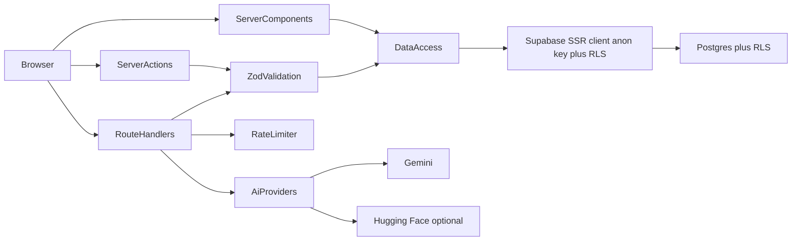
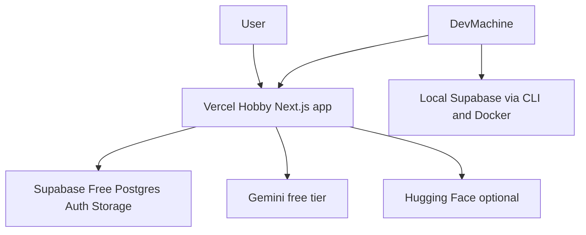

# INKORA Architecture

This document describes the intended architecture for INKORA. It is written before application code exists and will be updated when implementation diverges.

Related documents:

- [development-phases.md](development-phases.md) — phased delivery plan
- [../README.md](../README.md) — project overview and status

---

## Goals

1. Portfolio-quality, maintainable full-stack application
2. Feature-oriented organization with clear boundaries
3. Server Components by default; small Client Component boundaries
4. Strong security defaults (RLS, server-side role checks, Zod validation)
5. Provider-independent AI integrations
6. Zero-cost operation on free tiers for core features
7. Incremental delivery that leaves the project working after every phase

---

## High-level stack

| Concern | Choice |
| --- | --- |
| UI framework | Next.js App Router, React, TypeScript (strict) |
| Styling | Tailwind CSS, shadcn/ui, Lucide |
| Animation | Motion (components), GSAP (scroll timelines), R3F (isolated 3D) |
| Auth / DB / Storage | Supabase (PostgreSQL, Auth, Storage, RLS) |
| Auth SSR | Official `@supabase/ssr` integration |
| Forms | React Hook Form + Zod |
| AI text | Gemini free tier behind a text-provider interface |
| AI image | Optional Hugging Face / local behind an image-provider interface |
| Package manager | pnpm |
| Local backend | Supabase CLI + Docker |
| Hosting | Vercel Hobby + Supabase Free |

---

## Folder structure

```text
src/
  app/
    (marketing)/          # Landing, about
    (discovery)/          # Gallery, detail, styles, placements
    (auth)/               # Login, register, reset, auth callback
    (dashboard)/          # Favorites, collections, settings
    studio/               # AI concept studio
    artists/              # Artist directory and profiles
    admin/                # Server-guarded admin UI
    api/                  # Route Handlers (search, ai/*, health)
  components/
    ui/                   # shadcn and design-system primitives
    layout/               # Header, footer, shells
    shared/               # Cross-feature presentational pieces
  features/
    discovery/
    tattoos/
    categories/
    collections/
    favorites/
    authentication/
    ai-studio/
    artists/
    admin/
  lib/
    supabase/             # server, browser, middleware/proxy, admin (server-only)
    ai/                   # provider interfaces + concrete providers
    validations/          # Shared Zod schemas when not feature-local
    rate-limit/           # Application-level rate limiting helpers
    env.ts                # Zod-validated environment (server vs public)
    utils/
  hooks/
  stores/                 # Zustand stores (only when genuinely shared)
  types/
  styles/
supabase/
  config.toml
  migrations/
  seed.sql
tests/
  unit/
  integration/
  e2e/
docs/
```

### Conventions

- File names: **kebab-case**
- Components: **PascalCase**
- Functions and variables: **camelCase**
- Types and interfaces: **PascalCase**
- Feature server modules import `server-only`
- Features may import from `lib/` and `components/`
- Features must not import another feature’s internals; each feature exposes a small `index.ts` public surface
- Pages primarily compose features and layout components
- Avoid generic abstractions for one-off operations

---

## Layering rules

```text
app/ (routes, layouts, metadata)
  → features/*/components (UI)
  → features/*/server (queries, mutations, actions)
  → lib/* (supabase, ai, env, utils)
  → Supabase / external providers
```

1. **Pages** compose; they do not own business rules.
2. **Components** stay focused on presentation and local interaction.
3. **Business logic** is reusable and testable in feature `server/` modules or `lib/`.
4. **Database access** lives in clearly named data-access modules.
5. **Validation schemas** live beside features (`schemas.ts`) or in `lib/validations/`.
6. **AI** is always accessed through provider interfaces.
7. No circular dependencies.
8. Prefer TypeScript types over `any`; prefer narrowing over unexplained assertions.

---

## Request and data flow



### When to use what

| Mechanism | Use for |
| --- | --- |
| Server Components | Default data fetching and page composition |
| Route Handlers | Public or client-consumed APIs (search, AI, health) |
| Server Actions | Focused server mutations with progressive enhancement |
| Client Components | Real interactivity only (forms, toggles, motion, 3D) |

Never expose secrets in client code. Prefer small client islands over page-level `"use client"`.

---

## Supabase and authentication model

### Clients

| Client | Location | Key | Purpose |
| --- | --- | --- | --- |
| Browser client | `lib/supabase/browser.ts` | anon / publishable | Client interactions under RLS |
| Server client | `lib/supabase/server.ts` | anon / publishable + cookies | SSR reads/writes under RLS |
| Admin client | `lib/supabase/admin.ts` | service role | Privileged server-only operations |

The service-role key must never ship to the browser.

### Session handling

Use Supabase’s official Next.js SSR patterns for cookie-based sessions and refresh. The exact Next.js entrypoint (`middleware` vs renamed proxy conventions) is verified against current Next.js docs in Phase 1 / Phase 3 before scaffolding.

### Profiles and roles

- `profiles` is created by a trigger on auth signup
- `profiles.role` distinguishes `user` and `admin`
- Role changes are restricted to `service_role` (column privileges and/or trigger)
- Admin UI and admin APIs verify role on the server; never trust a client-supplied role claim

### Row Level Security

- RLS enabled on all user-accessible tables
- Users manage only their own favorites and private collections
- Public catalog content is readable according to explicit policies
- Integration tests against the local stack verify ownership and unauthorized admin access

---

## Domain entities (planned)

Initial tables:

- `profiles`
- `tattoos`
- `categories`
- `styles`
- `placements`
- `tags`
- `tattoo_styles`
- `tattoo_placements`
- `tattoo_tags`
- `favorites`
- `collections`
- `collection_items`
- `ai_generations`
- `ai_generation_images`
- `artist_profiles`

Additional table proposed in Phase 17 (flagged before implementation):

- `consultation_requests` — store consultation form submissions only (no messaging)

Tattoo content fields should include licensing metadata where applicable: `source`, `attribution`, `license`, `is_demo`.

A detailed schema document (`docs/database-schema.md`) is created in Phase 4 when migrations exist.

---

## AI provider interfaces

AI integrations must remain provider-independent.

### Text provider

Responsibilities:

- Tattoo concept generation
- Symbolism explanations
- Concept refinement
- Descriptive visual prompts

Rules:

- Gemini free tier is the first concrete provider
- All responses validated with Zod before use
- API keys stay server-side
- Application-level rate limits and per-user usage caps
- Quota / 429 errors surface as clear “try later” UI states
- Free-tier data terms disclosed in the product UI when AI ships

### Image provider (optional)

Responsibilities:

- Generate visual tattoo references when a free provider is available

Rules:

- Optional feature flag
- Hugging Face ZeroGPU or local generation as candidates
- Never auto-fallback to a paid provider
- Unavailable state must be honest; stock / licensed reference imagery must never be labeled as AI-generated
- Rest of the app must work without image generation

Concrete modules (planned):

```text
lib/ai/
  text-provider.ts
  image-provider.ts
  providers/gemini.ts
  providers/hugging-face.ts
```

---

## Caching strategy

- Public catalog reads: cache and revalidate where safe
- Authenticated / user-specific reads: remain dynamic
- Avoid duplicate fetches for the same data on a single page when possible
- Do not cache AI responses as if they were static catalog content without an explicit reason

---

## Image and media strategy

- Prefer correct aspect ratios, lazy loading, and responsive `sizes`
- Use Next.js Image where compatible
- Pre-size thumbnails at upload where practical (Vercel Hobby optimization quotas)
- Avoid paid Supabase image transforms
- Store attribution and license data with tattoos
- Seed and demo content must be clearly identified
- Do not scrape or redistribute copyrighted portfolios

---

## Animation and 3D strategy

- Motion: component transitions
- GSAP: complex scroll timelines (landing storytelling)
- React Three Fiber: isolated hero/3D moments only
- Never animate the same element with both Motion and GSAP
- Lazy-load GSAP and Three bundles (`next/dynamic`)
- Respect `prefers-reduced-motion` with static fallbacks

---

## Security model

1. RLS on by default for user-accessible tables
2. Zod validation at every mutation and AI / search boundary
3. Ownership checks before sensitive mutations
4. Admin checks on the server using database role, not client input
5. Users cannot promote themselves to admin
6. Rate-limit AI endpoints using Postgres-backed counters (no paid Redis)
7. Never log or return secrets, internal DB errors, or stack traces to clients
8. `.env.example` lists names only; no invented credentials in docs or code

---

## Environment configuration

`lib/env.ts` validates environment variables with Zod and splits:

- **Public** variables safe for the browser (`NEXT_PUBLIC_*`)
- **Server** variables (API keys, service role, etc.)

Missing required server variables should fail loudly at startup or first use of the affected feature, with clear developer messaging — not silent fallbacks to paid services.

---

## Testing architecture

| Layer | Tool | Focus |
| --- | --- | --- |
| Unit | Vitest | Utils, schemas, business logic |
| Component | Vitest + React Testing Library | Interactive UI |
| Integration | Vitest + local Supabase | Data access, RLS policies |
| E2E | Playwright | Critical user journeys |

Critical journeys (covered by Phase 18, built earlier where possible):

1. Browse tattoo gallery
2. Search and filter tattoos
3. View tattoo details
4. Register and log in
5. Save a favorite
6. Create and edit a collection
7. Generate AI concepts
8. Refine an AI concept
9. Verify private collection access
10. Verify unauthorized admin access is rejected

Do not claim tests pass unless they were executed.

---

## Deployment architecture



- Local development and integration tests: Docker + Supabase CLI
- Production: Vercel Hobby + hosted Supabase Free
- No mandatory paid dependency for core discovery, auth, favorites, or collections

---

## Architectural risks and mitigations

| Risk | Mitigation |
| --- | --- |
| Supabase Free pauses inactive projects | Document in README; health route; no hidden keep-alive |
| Gemini quota / terms change | Verify and date limits in Phase 13; disclose free-tier data use; handle 429 |
| HF ZeroGPU cold starts / timeouts | Optional flag; timeouts; honest unavailable UI; no paid fallback |
| Serverless rate limiting without Redis | Count `ai_generations` per user/window in Postgres |
| Vercel image optimization quota | Pre-sized thumbnails; fixed `sizes`; document limits; Storage URL fallback |
| RLS mistakes | Default-deny policies; local integration tests for ownership and admin |
| Caching private data | Keep auth reads dynamic |
| three.js / GSAP bundle weight | Lazy-load on landing only; reduced-motion fallback |
| Content licensing | `source` / `attribution` / `license` / `is_demo`; no scraping |
| Fast-moving Next / Tailwind / shadcn APIs | Verify current docs before Phase 1 scaffolding |
| Consultation table not in original entity list | Propose `consultation_requests` in Phase 17 and wait for confirmation |

---

## Documentation policy

- Never document features that do not exist
- README sections for unimplemented areas use clear “not available yet” placeholders
- `database-schema.md` and `api-reference.md` are created when migrations / APIs land
- `product-specification.md` is written when product decisions stabilize enough to avoid fiction

---

## Change control

Architecture decisions that deviate from this document must be explained before implementation, especially:

- Stack substitutions
- New paid dependencies
- New top-level folders that break feature boundaries
- New tables beyond the planned set
