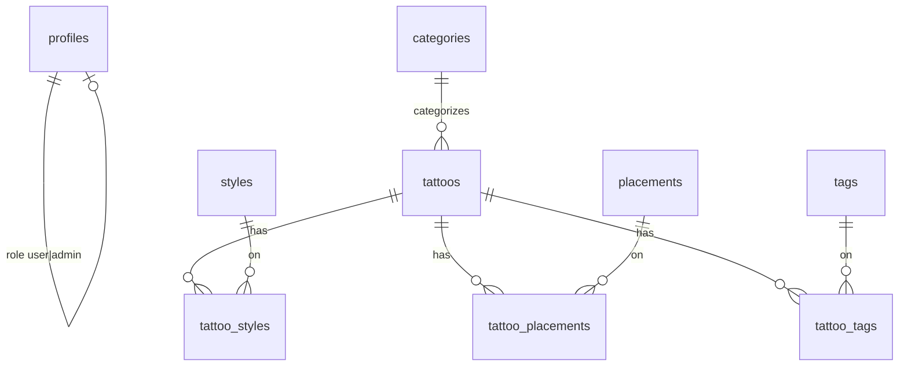

# INKORA Database Schema

This document matches the version-controlled SQL migrations under [`supabase/migrations/`](../supabase/migrations/).

Last updated: Phase 18 (artists + consultations + admin policies).

---

## Overview

| Area | Tables | Notes |
| --- | --- | --- |
| Auth profiles | `profiles` | Created on signup; role protected |
| Catalog taxonomies | `categories`, `styles`, `placements`, `tags` | Public read |
| Catalog content | `tattoos`, `tattoo_styles`, `tattoo_placements`, `tattoo_tags` | Published rows are public |
| User saves | `favorites`, `collections`, `collection_items` | Owner RLS; public collections readable |
| AI | `ai_generations`, `ai_generation_images` | Private to owner; admins can read metrics |
| Artists | `artist_profiles`, `artist_tattoos` | Published public read; admin write |
| Consultations | `consultation_requests` | Store-only inserts; admin/artist select |
| Storage | buckets `tattoo-images`, `ai-generation-images` | Catalog public; AI images private per user folder |

---

## Entity relationship (catalog)



---

## Tables

### `profiles` (Phase 3)

| Column | Type | Notes |
| --- | --- | --- |
| `id` | `uuid` PK | FK → `auth.users.id` |
| `display_name` | `text` | Optional, ≤ 80 chars |
| `role` | `user_role` | `user` \| `admin`; default `user` |
| `created_at` / `updated_at` | `timestamptz` | |

**Security**

- RLS enabled
- Users can select/update their own row
- Authenticated users can update only `display_name`, `updated_at`
- Role changes blocked unless JWT role is `service_role`
- Signup trigger `handle_new_user` inserts a profile with role `user`

### `categories` / `styles` / `placements` / `tags`

Shared shape (tags omit `description`):

| Column | Type | Notes |
| --- | --- | --- |
| `id` | `uuid` PK | |
| `name` | `text` | Required |
| `slug` | `text` unique | kebab-case |
| `description` | `text` | Optional (not on `tags`) |
| `created_at` / `updated_at` | `timestamptz` | |

### `tattoos`

| Column | Type | Notes |
| --- | --- | --- |
| `id` | `uuid` PK | |
| `title` | `text` | |
| `slug` | `text` unique | |
| `description` | `text` | |
| `category_id` | `uuid` FK | nullable |
| `image_path` | `text` | App path or storage object path |
| `image_alt` | `text` | Accessibility text |
| `image_width` / `image_height` | `integer` | Optional |
| `source` | `text` | Origin of the asset |
| `attribution` | `text` | Credit line |
| `license` | `text` | Usage terms |
| `is_demo` | `boolean` | Demo/synthetic content flag |
| `is_published` | `boolean` | Public visibility |
| `is_featured` | `boolean` | Landing/featured surfaces |
| `search_vector` | `tsvector` | Generated FTS column |
| `created_at` / `updated_at` | `timestamptz` | |

### Join tables

- `tattoo_styles (tattoo_id, style_id)`
- `tattoo_placements (tattoo_id, placement_id)`
- `tattoo_tags (tattoo_id, tag_id)`

Composite primary keys; cascade on tattoo/taxonomy delete.

---

## Indexes

- Slug indexes on taxonomies and tattoos
- `tattoos(category_id)`
- `tattoos(is_published, is_featured, created_at desc)`
- GIN index on `tattoos.search_vector`
- Reverse FK indexes on join tables

---

## Full-text search

`tattoos.search_vector` weights:

- **A** — title
- **B** — description
- **C** — attribution

Example query shape (implemented in Phase 5/8 data-access):

```sql
select *
from public.tattoos
where is_published = true
  and search_vector @@ websearch_to_tsquery('english', 'moon floral');
```

---

## Row Level Security

| Table | `anon` / `authenticated` read | Write |
| --- | --- | --- |
| Taxonomies | all rows | admins only (`is_admin()`) |
| `tattoos` | `is_published = true` | admins only |
| Join tables | when linked tattoo is published | admins only |
| `profiles` | own row | own display fields; role locked |
| `favorites` | own rows | own insert/delete |
| `collections` | own + public | own insert/update/delete |
| `collection_items` | via collection ownership / public | owners only |
| `ai_generations` / `ai_generation_images` | own rows | own insert/delete |
| `storage.objects` (`tattoo-images`) | public read | admins only |
| `storage.objects` (`ai-generation-images`) | own folder | own upload/delete |

`service_role` bypasses RLS (seeds, admin tooling, trusted server jobs).

Helper: `public.is_admin()` — true when the authenticated user's profile role is `admin`.

---

## Storage

Bucket: **`tattoo-images`**

- Public read
- MIME allow-list: jpeg, png, webp, svg
- File size limit: 5 MiB
- Seed demo images currently live in the Next.js `public/demo/tattoos/` folder and are referenced by `image_path` (no portfolio scraping)

---

## Seed content policy

[`supabase/seed.sql`](../supabase/seed.sql) inserts clearly labeled **synthetic demo artwork**:

- `is_demo = true`
- `source = 'INKORA demo assets'`
- `license` states demo-only usage
- One unpublished row exists to verify RLS hide behavior

No scraped tattoo portfolios are included.

---

## Migrations

| File | Purpose |
| --- | --- |
| `20261106190000_create_profiles.sql` | Profiles, role protection, signup trigger |
| `20261106200000_create_catalog_schema.sql` | Catalog, FTS, RLS, storage bucket |
| `20261107010000_create_favorites_collections_ai.sql` | Favorites, collections, AI tables + AI image bucket |
| `20261107020000_create_artists_admin_policies.sql` | Artists, consultations, admin AI select policies |

Apply locally:

```bash
pnpm db:reset
```
