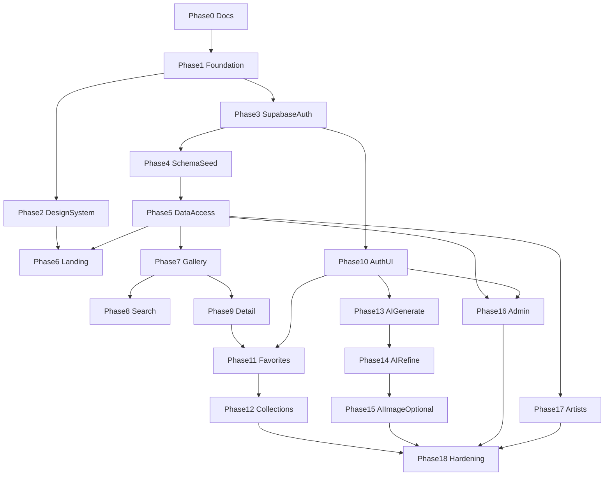

# INKORA Development Phases

INKORA is delivered in **18 incremental phases**. Each phase:

1. Is independently reviewable
2. Leaves the repository in a working state
3. Ends with an implementation report and a suggested commit message
4. Stops until you explicitly approve the next phase

You create every Git commit manually. The agent must not commit, push, create branches, rewrite history, or stage files unless you explicitly ask.

Related documents:

- [architecture.md](architecture.md)
- [../README.md](../README.md)

---

## Phase workflow (every phase)

1. **Inspect** — Read relevant existing files
2. **Plan** — State intent and files that will change
3. **Implement** — Only the requested phase
4. **Verify** — Run appropriate lint, typecheck, and tests
5. **Review** — Duplication, security, readability
6. **Report** — Summary + suggested commit message
7. **Stop** — Wait for approval

### End-of-phase report template

1. What was implemented
2. Files created
3. Files modified
4. Dependencies added and why
5. Tests executed and their actual results
6. Known limitations
7. Manual verification instructions
8. Suggested commit message

---

## Status legend

| Status | Meaning |
| --- | --- |
| Not started | No work begun |
| In progress | Currently being implemented |
| Done | Completed and approved by you |

Current overall status: **Phases 0–18 complete.**

---

## Phase 0 — Founding documents

**Status:** Done (this document set)

### Scope

- Inspect empty repository
- Recommend folder structure, dependencies, and risks
- Create founding documentation only (no application code)

### Deliverables

- `README.md`
- `docs/architecture.md`
- `docs/development-phases.md`

### Acceptance criteria

- [x] Repository state documented honestly
- [x] Eighteen phases defined with scope, deliverables, tests, and acceptance criteria
- [x] Architecture and risks recorded
- [x] No application scaffolding yet

---

## Phase 1 — Project foundation

**Status:** Done

### Scope

Scaffold the Next.js App Router project with strict TypeScript, Tailwind, shadcn/ui baseline, linting, formatting, and test runners. Verify current Next.js / Tailwind / shadcn docs before scaffolding (including any middleware/proxy naming changes).

### Deliverables

- Next.js + React + TypeScript (strict) project under the agreed structure
- Tailwind CSS + shadcn/ui initialization
- ESLint + Prettier (+ Tailwind class sorting plugin)
- Vitest + React Testing Library + Playwright config
- `lib/env.ts` skeleton (Zod-validated; names only in `.env.example`)
- pnpm scripts: `dev`, `build`, `lint`, `typecheck`, `test`, `test:e2e`, `check`
- Minimal root layout and placeholder home page that builds

### Tests

- `pnpm typecheck` passes
- `pnpm lint` passes
- At least one sample Vitest unit test passes
- Playwright project boots (smoke config; full journeys later)

### Acceptance criteria

- [x] App starts with `pnpm dev`
- [x] Production build succeeds
- [x] Strict TypeScript enabled
- [x] No invented secrets; `.env.example` lists names only
- [x] README installation / local commands sections updated to match reality

---

## Phase 2 — Design system and layout

**Status:** Done

### Scope

Establish the premium editorial visual identity: tokens, typography, layout chrome, and base UI primitives. Prefer Motion for simple transitions; do not introduce GSAP or Three.js yet unless needed for shared reduced-motion utilities only.

### Deliverables

- Color tokens: Ink Black `#171717`, Warm White `#F7F5F0`, Paper `#EAE6DE`, Muted Gray `#888780`, Burgundy `#753D43`
- Typography: Instrument Serif (or Cormorant) headings; Geist / Inter body; Geist Mono labels
- Spacing and type scale tokens
- Base shadcn components needed for layout (button, input, etc. as required)
- Header, footer, navigation
- Focus styles and `prefers-reduced-motion` utilities
- Shared `error.tsx` / `not-found.tsx` patterns where appropriate
- README design notes updated if needed

### Tests

- Component smoke tests for header/nav interactive bits if client-driven
- Visual sanity via manual checklist (mobile / tablet / desktop)

### Acceptance criteria

- [x] Tokens used consistently; burgundy used sparingly
- [x] Responsive layout shell
- [x] Accessible focus states
- [x] Reduced-motion respected for any introduced transitions
- [x] No dashboard-generic aesthetic

---

## Phase 3 — Supabase and auth infrastructure

**Status:** Done

### Scope

Local Supabase stack (CLI + Docker), SSR auth clients, session refresh, and `profiles` with protected roles.

### Deliverables

- `supabase/` config, first migrations for `profiles`
- Signup trigger creating profiles
- `lib/supabase/{server,browser,middleware|proxy,admin}.ts`
- Admin role protection (users cannot self-promote)
- Auth callback route scaffolding
- `.env.example` updated with Supabase variable **names**
- README Supabase local setup instructions

### Tests

- Integration: profile created on signup (local stack)
- Integration: non-admin cannot escalate role
- Unit: env parsing for public vs server keys

### Acceptance criteria

- [x] Local Supabase starts via documented pnpm scripts
- [x] SSR session pattern verified against current Supabase + Next.js docs
- [x] Service-role client is server-only
- [x] RLS enabled on `profiles`

---

## Phase 4 — Content schema and seed

**Status:** Done

### Scope

Catalog schema, indexes, RLS, storage bucket, and licensed / demo seed data. Create `docs/database-schema.md`.

### Deliverables

- Tables: `categories`, `styles`, `placements`, `tags`, `tattoos`, join tables, licensing columns (`source`, `attribution`, `license`, `is_demo`)
- Full-text search column / indexes as appropriate
- Storage bucket for tattoo images
- `supabase/seed.sql` with clearly labeled demo / original / licensed content
- `docs/database-schema.md`

### Tests

- Migration applies cleanly on local stack
- Seed loads successfully
- RLS policies smoke-tested for public read vs private write

### Acceptance criteria

- [x] All planned catalog entities exist with FKs, indexes, timestamps
- [x] No scraped copyrighted portfolios
- [x] Schema doc matches migrations
- [x] README migration / seed sections updated

---

## Phase 5 — Data-access layer

**Status:** Done

### Scope

Generated database types and typed query modules for the public catalog. No full gallery UI yet.

### Deliverables

- Generated Supabase types under `src/types` (or agreed path)
- Feature data-access modules for tattoos / taxonomies
- Shared query helpers (pagination primitives, slug lookups)
- Integration tests against local DB

### Tests

- Integration: list tattoos, get by slug, filter primitives
- Unit: pure mapping / pagination helpers

### Acceptance criteria

- [x] No raw untyped client usage in features that already have modules
- [x] Server modules use `server-only`
- [x] Tests run against local Supabase and pass

---

## Phase 6 — Marketing landing page

**Status:** Done

### Scope

Editorial landing experience with restrained motion and one isolated, lazy-loaded 3D moment.

### Deliverables

- Marketing route group landing page
- GSAP scroll storytelling (landing only)
- Lazy-loaded React Three Fiber hero element with static fallback
- Featured tattoos section (from seed / data-access)
- Metadata / Open Graph basics
- Motion only where it does not conflict with GSAP on the same element

### Tests

- Unit/component tests for non-3D interactive pieces as needed
- Manual reduced-motion verification
- Bundle check: Three/GSAP not loaded on unrelated routes

### Acceptance criteria

- [x] Premium editorial feel, not SaaS dashboard
- [x] `prefers-reduced-motion` yields static experience
- [x] Expensive libs are lazy-loaded
- [x] Page works if featured query returns empty (empty state)

---

## Phase 7 — Discovery gallery

**Status:** Done

### Scope

Core tattoo gallery grid with loading, empty, and error states.

### Deliverables

- Discovery gallery route(s)
- Responsive image grid with placeholders / skeletons
- Pagination or infinite loading (justify TanStack Query if used)
- `loading.tsx` / error / empty UX

### Tests

- Component tests for gallery states
- E2E smoke: browse gallery
- Integration: gallery query pagination

### Acceptance criteria

- [x] Works on mobile, tablet, desktop
- [x] Images lazy-load with sensible `sizes`
- [x] Empty and error states are clear
- [x] Server Components used by default

---

## Phase 8 — Search and filtering

**Status:** Done

### Scope

URL-driven search and filters backed by Postgres full-text search. Create `docs/api-reference.md` for public search API.

### Deliverables

- Filter state in the URL (shareable)
- Style, placement, category (and tag if ready) filters
- Search Route Handler and/or server query module
- `docs/api-reference.md` (existing endpoints only)

### Tests

- Integration: FTS and filter combinations
- E2E: search and filter tattoos
- Unit: Zod schemas for search params

### Acceptance criteria

- [x] Filters are bookmarkable via URL
- [x] Invalid params rejected safely
- [x] API reference matches implementation
- [x] No silent failures

---

## Phase 9 — Tattoo detail pages

**Status:** Done

### Scope

Detail view with attribution, related tattoos, and metadata.

### Deliverables

- `tattoos/[slug]` detail page
- Attribution / license / demo labeling
- Related tattoos
- Dynamic metadata
- `not-found` handling

### Tests

- Integration: slug lookup and 404
- E2E: view tattoo details
- Metadata smoke (title/description present)

### Acceptance criteria

- [x] Licensing info visible when present
- [x] Unknown slug returns not-found
- [x] Related section degrades gracefully when empty

---

## Phase 10 — Authentication UI

**Status:** Done

### Scope

User-facing auth flows with React Hook Form + Zod, wired to Supabase Auth.

### Deliverables

- Register, log in, log out, password reset UI
- Auth callback handling
- Protected route patterns for dashboard areas
- Validation schemas and accessible form errors

### Tests

- Component tests for form validation
- E2E: register and log in (local Supabase)
- Ensure secrets never appear in client bundles

### Acceptance criteria

- [x] Happy-path auth works against local stack
- [x] Clear error states for invalid credentials
- [x] Protected routes redirect unauthenticated users
- [x] README auth-related env notes updated if needed

---

## Phase 11 — Favorites

**Status:** Done

### Scope

RLS-backed favorites with optimistic UI.

### Deliverables

- Favorite toggle on eligible tattoo surfaces
- Favorites dashboard page
- Data-access + mutations with ownership via RLS
- Optimistic UI with rollback on failure

### Tests

- Integration: user can only mutate own favorites
- E2E: save a favorite
- Component: toggle states

### Acceptance criteria

- [x] Unauthenticated users prompted to sign in
- [x] RLS prevents cross-user mutation
- [x] Loading / error / success feedback present

---

## Phase 12 — Collections

**Status:** Done

### Scope

Personal collections with privacy controls.

### Deliverables

- Create, edit, delete collections
- Add / remove collection items
- Private vs public visibility
- Collection detail UI under dashboard

### Tests

- Integration: private collection inaccessible to other users
- E2E: create and edit a collection
- Ownership mutation tests

### Acceptance criteria

- [x] Private collections enforced by RLS
- [x] Empty states for new collections
- [x] No duplicated business logic across pages

---

## Phase 13 — AI Studio: concept generation

**Status:** Done

### Scope

Text AI concept generation behind a provider interface, Gemini free tier first. Verify and date current free-tier limits in the phase report and docs.

### Deliverables

- `lib/ai` text-provider interface + Gemini provider
- Studio UI for generating concepts
- Zod validation of model output
- Postgres-backed rate limits / usage caps
- Persist to `ai_generations`
- Free-tier data-use disclosure in UI
- README AI configuration section (names only for secrets)

### Tests

- Unit: schema validation / provider mapping with fixtures
- Integration: rate limit enforcement
- E2E: generate AI concept (may mock provider in CI if keys absent — document clearly)

### Acceptance criteria

- [x] API keys never exposed to the browser
- [x] Invalid model JSON never trusted
- [x] 429 / quota surfaces as “try later”
- [x] App remains usable without calling AI on other routes
- [x] No paid fallback introduced

---

## Phase 14 — AI concept refinement and history

**Status:** Done

### Scope

Iterative refinement, symbolism, visual prompts, history, and save-into-collections hooks.

### Deliverables

- Refine existing concepts
- Symbolism explanations and visual prompt helpers
- Generation history UI
- Save concept artifacts into collections where appropriate

### Tests

- Unit: refinement request schemas
- E2E: refine an AI concept
- Integration: history scoped to owning user

### Acceptance criteria

- [x] History is private to the user
- [x] Refinement continues to enforce rate limits
- [x] Clear empty/history states

---

## Phase 15 — Optional image generation

**Status:** Done

### Scope

Optional image provider. Confirm a workable free Hugging Face approach before adding the dependency. If not reliable for free, ship unavailable state + licensed reference path only.

### Deliverables

- Image-provider interface
- Concrete provider only if free path is viable
- `ai_generation_images` + Storage wiring
- Feature flag / unavailable UI
- Licensed reference imagery path clearly labeled **not** AI-generated
- README free-tier limitations updated with dated notes

### Tests

- Unit: unavailable provider behavior
- Integration: persistence when generation succeeds
- E2E: unavailable state path (always); success path if provider available

### Acceptance criteria

- [x] Core app works with image generation disabled
- [x] No automatic paid fallback
- [x] Stock/licensed images never claimed as AI-generated
- [x] Timeouts handled cleanly

---

## Phase 16 — Admin dashboard

**Status:** Done

### Scope

Server-verified admin area for catalog and taxonomy management.

### Deliverables

- Admin layout guarded on the server
- Tattoo and taxonomy management UI
- Upload flow with required license fields
- AI usage overview (read-only metrics)
- Reject non-admin access

### Tests

- E2E / integration: unauthorized admin access rejected
- Integration: admin-only mutations
- Validation tests for license-required uploads

### Acceptance criteria

- [x] Non-admins cannot access admin UI or APIs
- [x] Role never trusted from the client
- [x] Uploads require attribution/license metadata

---

## Phase 17 — Artists

**Status:** Done

### Scope

Artist discovery and portfolios. Propose `consultation_requests` table before implementing (not in the original entity list).

### Deliverables

- `artist_profiles` (and portfolio linkage to tattoos or dedicated media as designed)
- Artist directory and `[slug]` profile pages
- Consultation request form that **stores** requests only (no messaging)
- Confirm `consultation_requests` with you before migration

### Tests

- Integration: public artist reads; consultation insert rules
- E2E smoke: browse artists / open profile / submit consultation (local)

### Acceptance criteria

- [x] No real-time messaging introduced
- [x] Consultation storage approved before schema change
- [x] Artist pages match editorial design language

---

## Phase 18 — Hardening and release

**Status:** Done

### Scope

Accessibility, performance, full E2E coverage of critical journeys, SEO, README completion, and Vercel Hobby deployment guide.

### Deliverables

- Accessibility and performance pass with documented results
- Full E2E suite for all 10 critical journeys
- `sitemap` / `robots`
- README complete: screenshots, env, Supabase, AI, deploy, free-tier limits, security, known limitations
- Align remaining docs with actual implementation
- `docs/product-specification.md` if still missing and content is real

### Tests

- Entire critical journey list executed; report real results
- Lint, typecheck, unit, integration, e2e in the phase report

### Acceptance criteria

- [x] All 10 critical journeys covered by automated E2E (or documented gaps with reason)
- [x] README has no features that do not exist
- [x] Deployment instructions work for Vercel Hobby + Supabase Free
- [x] Zero paid mandatory dependencies for core features

---

## Critical user journeys (E2E targets)

Covered by Playwright under `tests/e2e/` (AI generation uses `INKORA_AI_MOCK=true` in Playwright webServer):

1. Browse tattoo gallery — `discovery.spec.ts`
2. Search and filter tattoos — `discovery.spec.ts`
3. View tattoo details — `discovery.spec.ts`
4. Register and log in — `auth.spec.ts`
5. Save a favorite — `favorites-collections.spec.ts`
6. Create and edit a collection — `favorites-collections.spec.ts`
7. Generate AI concepts — `studio-ai.spec.ts` (mock provider)
8. Refine an AI concept — `studio-ai.spec.ts` (mock provider)
9. Verify private collection access — `collections-privacy.spec.ts`
10. Verify unauthorized admin access is rejected — `admin.spec.ts`

---

## Phase dependency overview

---

## Rules reminder

- One phase per implementation session unless you explicitly allow combining phases
- Do not invent credentials, env values, or external API availability
- Do not replace real functionality with fake data unless clearly labeled demo data
- Do not begin the next phase until you explicitly request it
